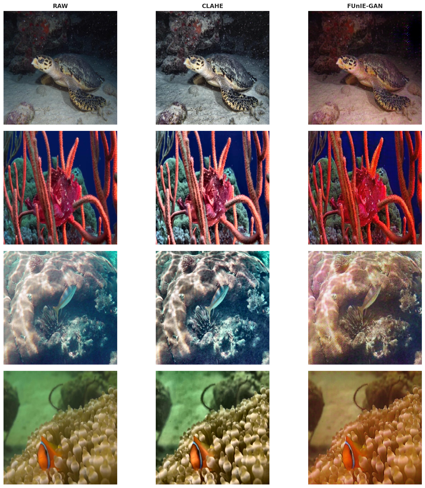
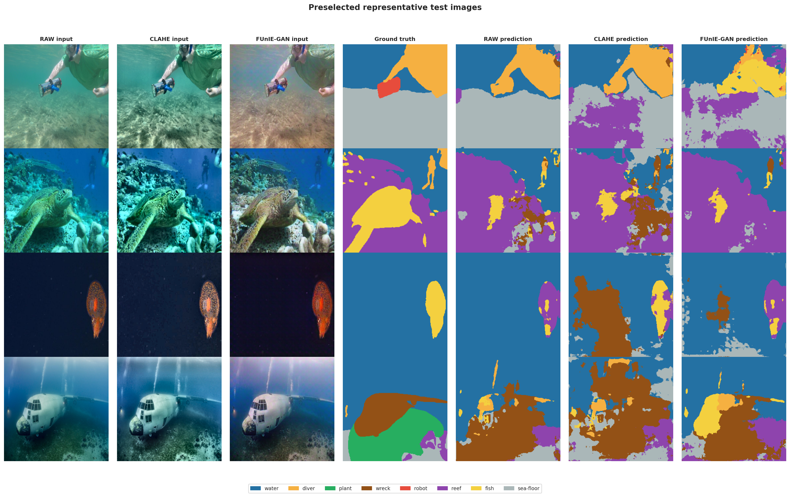
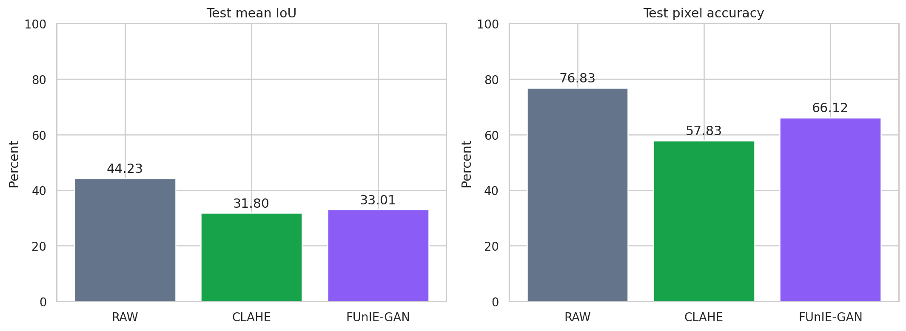
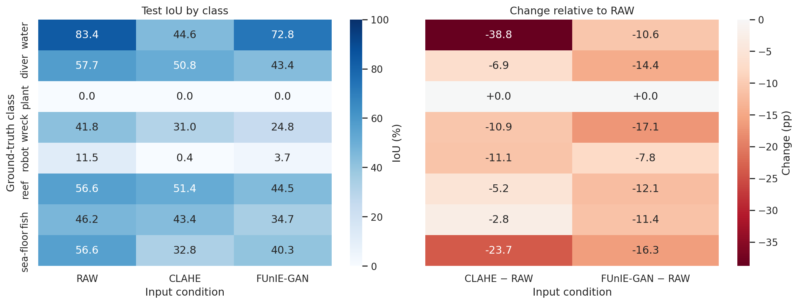
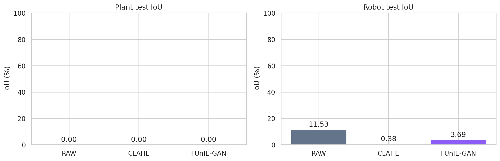
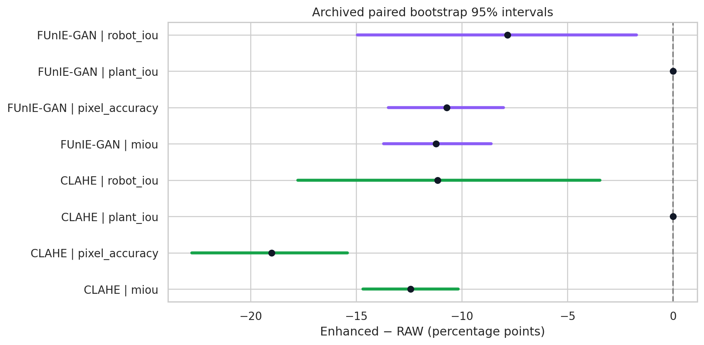
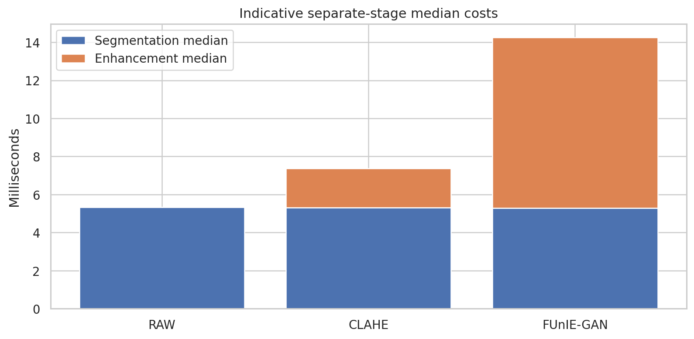

<div align="center">

# 🌊 Underwater Image Enhancement for Robotic Segmentation

### Evaluating Underwater Image Enhancement for CNN-Based Robotic Segmentation

**A controlled deep learning research study exploring whether visually enhanced underwater images improve semantic segmentation for robotic perception.**


**[Research Notebooks](notebooks/)** · **[Experimental Results](results/)** · **[Source Code](src/)**

</div>

---

## 🔍 Research Overview

Underwater environments present significant challenges for computer vision systems. Light absorption, scattering, reduced contrast, and color distortion can make it difficult for autonomous underwater robots to accurately identify objects in their surroundings.

Image enhancement techniques are commonly used to improve the visual appearance of underwater images. However, improving visual quality does not necessarily improve how a deep learning model interprets an image.

This research investigates a central question:

> **Does underwater image enhancement improve the semantic segmentation performance of a convolutional neural network?**

To investigate this, three image conditions were evaluated using the same frozen U-Net segmentation model:

| Method | Description |
|---|---|
| **RAW** | Original underwater images without enhancement |
| **CLAHE** | Contrast Limited Adaptive Histogram Equalization |
| **FUnIE-GAN** | Pretrained GAN-based underwater image enhancement |

The experiments evaluate segmentation accuracy, class-specific performance, statistical uncertainty, and computational efficiency.

---

## 🎯 Research Objectives

1. Evaluate whether underwater image enhancement improves CNN-based semantic segmentation.
2. Compare traditional contrast enhancement with GAN-based enhancement.
3. Investigate enhancement effects on individual semantic classes, particularly underwater plants and robots.
4. Measure the additional computational cost introduced by image enhancement.
5. Determine whether visually improved images translate into better downstream robotic perception.

---

## 🧠 Experimental Methodology

### Dataset

The research uses the **SUIM (Semantic Segmentation of Underwater Imagery)** dataset.

| Dataset Component | Count |
|---|---:|
| Training images | 1,204 |
| Validation images | 214 |
| Official test images | 110 |
| Semantic classes | 8 |
| Input resolution | 256 × 256 |

**Segmentation classes:** Water, Diver, Plant, Wreck, Robot, Reef, Fish, and Sea-floor.

### Model Architecture

A U-Net convolutional neural network was trained on original underwater images to perform pixel-level semantic segmentation.

The selected model checkpoint was obtained at **epoch 112**.

The same frozen model was then used to evaluate all three image conditions.

### Experimental Pipeline

```text
                    SUIM Dataset
                         |
                Data Exploration
                         |
             Cleaning and Validation
                         |
                 Train RAW U-Net
                         |
                Freeze Model Weights
                         |
                110 Test Images
                         |
          +--------------+--------------+
          |              |              |
         RAW           CLAHE        FUnIE-GAN
          |              |              |
          +--------------+--------------+
                         |
                   Frozen U-Net
                         |
                Segmentation Results
                         |
              +----------+----------+
              |          |          |
           Mean IoU    Per-Class   Accuracy
                         |
                Statistical Analysis
                         |
                Research Conclusions
```

**Controlled evaluation:** No U-Net retraining or fine-tuning was performed between the RAW, CLAHE, and FUnIE-GAN conditions.

This isolates the effects of applying enhancement at inference time to a model trained on original images.

---

## 🖼️ Visual Comparison

### Underwater Image Enhancement



*Visual comparison of original underwater images and their enhanced counterparts.*

### Semantic Segmentation



*Representative segmentation predictions across the three image conditions.*

---

## 📊 Experimental Results

### Overall Segmentation Performance



| Input Condition | Mean IoU | Pixel Accuracy | Δ Mean IoU vs RAW |
|---|---:|---:|---:|
| **RAW** | **44.23%** | **76.83%** | Baseline |
| CLAHE | 31.80% | 57.83% | −12.42 pp |
| FUnIE-GAN | 33.01% | 66.12% | −11.22 pp |

*pp = percentage points.*

### Key Observation

**The RAW-trained U-Net achieved its highest segmentation performance on the original, unenhanced images.**

Both CLAHE and FUnIE-GAN reduced segmentation accuracy under the frozen-model evaluation protocol.

Although FUnIE-GAN performed better than CLAHE, neither enhancement method outperformed the RAW baseline.

### Per-Class Segmentation Analysis



Individual semantic classes responded differently to the enhancement methods.

Special attention was given to the **plant** and **robot** classes because of their relevance to underwater robotic perception.



The model showed substantial difficulty identifying underwater plants, with no correct plant-class predictions across the evaluated conditions.

Robot segmentation also deteriorated under both enhancement methods.

---

## 📈 Statistical Validation

To evaluate the reliability of the observed performance differences, the study used **2,000 paired bootstrap resamples** across the 110 official test images.



| Comparison | Δ Mean IoU | 95% Confidence Interval |
|---|---:|---:|
| CLAHE − RAW | −12.42 pp | [−14.67, −10.16] pp |
| FUnIE-GAN − RAW | −11.22 pp | [−13.70, −8.60] pp |

Both confidence intervals fall below zero, indicating consistent negative performance differences across the paired bootstrap samples.

---

## ⚡ Computational Efficiency

Image enhancement introduces additional processing overhead, an important consideration for real-time robotic vision systems.



| Method | Median Enhancement Time | Median Segmentation Time |
|---|---:|---:|
| RAW | 0.00 ms | 5.34 ms |
| CLAHE | 2.07 ms | 5.31 ms |
| FUnIE-GAN | 8.95 ms | 5.29 ms |

*These measurements reflect the recorded experimental environment and are not embedded-device benchmarks.*

In this study, both enhancement methods increased processing cost without improving downstream segmentation accuracy.

---

## 💡 Key Research Findings

**1. Better visual appearance does not guarantee better segmentation.**

Image enhancement may improve contrast or color while simultaneously reducing the accuracy of a model trained on unenhanced images.

**2. Input distribution matters.**

Enhancement changes the visual characteristics of the input data. This can introduce a mismatch between training and inference conditions.

**3. Class-specific limitations remain important.**

Difficult semantic categories, including underwater plants and robots, require more targeted investigation than general-purpose enhancement alone.

**4. Computational efficiency must be considered.**

For robotic applications, additional preprocessing should provide measurable downstream benefits that justify its computational cost.

**5. Enhancement should be evaluated using task-specific metrics.**

Visual quality and segmentation accuracy are different objectives. A method that improves one may not improve the other.

---

## ⚠️ Research Limitations

- The experiments used one U-Net segmentation architecture.
- The model was trained exclusively on RAW images.
- Enhancement was applied at inference time without retraining.
- Evaluation was conducted on 110 official test images.
- Some semantic classes had limited representation.
- Real-time deployment on physical underwater robotic hardware was not evaluated.

**The findings do not imply that underwater image enhancement is universally harmful to semantic segmentation.**

They demonstrate that the evaluated enhancement methods did not improve performance when applied to this particular frozen RAW-trained model.

---

## 🚀 Future Research Directions

- Training segmentation models directly on enhanced underwater images.
- Comparing RAW-trained and enhancement-trained segmentation models.
- Investigating task-aware enhancement methods.
- Evaluating transformer-based segmentation architectures.
- Addressing class imbalance and difficult object categories.
- Testing segmentation pipelines on embedded underwater robotic systems.

---

## 📁 Repository Structure

```text
underwater-robotic-segmentation/
│
├── notebooks/
│   ├── 01_data_exploration_cleaning.ipynb
│   ├── 02_unet_baseline.ipynb
│   ├── 03_underwater_image_enhancement.ipynb
│   ├── 04_controlled_segmentation_evaluation.ipynb
│   └── 05_final_research_analysis.ipynb
│
├── src/
│   ├── common.py
│   ├── dataset.py
│   ├── unet.py
│   ├── train.py
│   ├── build_manifest.py
│   └── fetch_funie.py
│
├── results/
│   ├── figures/
│   └── tables/
│
├── environment.yml
├── .gitignore
└── README.md
```

---

## 📓 Research Notebooks

| Notebook | Description |
|---|---|
| [01 — Data Exploration and Cleaning](notebooks/01_data_exploration_cleaning.ipynb) | Dataset inspection, cleaning, validation, and manifest creation |
| [02 — U-Net Baseline](notebooks/02_unet_baseline.ipynb) | Model training, validation, and checkpoint selection |
| [03 — Image Enhancement](notebooks/03_underwater_image_enhancement.ipynb) | CLAHE and FUnIE-GAN enhancement experiments |
| [04 — Segmentation Evaluation](notebooks/04_controlled_segmentation_evaluation.ipynb) | Controlled evaluation, class-level metrics, and statistical analysis |
| [05 — Final Research Analysis](notebooks/05_final_research_analysis.ipynb) | Consolidated findings, visualizations, and interpretation |

---

## 🔬 Reproducibility

The repository provides:

- Research notebooks and supporting Python source code.
- Experiment configuration records.
- Dataset cleaning manifests and exclusion records.
- Segmentation performance metrics.
- Paired bootstrap confidence intervals.
- Research figures and visual comparisons.

### Environment

The project uses Python 3.12, PyTorch, and supporting scientific computing and computer vision libraries.

The current `environment.yml` specifies the Python environment but does not contain a complete pinned dependency list.

### Data and Pretrained Models

Large datasets, model checkpoints, and third-party pretrained weights are excluded from the repository.

The research uses:

- **SUIM:** Semantic Segmentation of Underwater Imagery dataset.
- **FUnIE-GAN:** [Original implementation](https://github.com/xahidbuffon/FUnIE-GAN).

The original experiments were conducted using Google Colab and Google Drive. Running the notebooks in another environment requires configuring the dataset and model paths and installing the required dependencies.

### Experiment Configuration

| Parameter | Value |
|---|---|
| Random seed | 42 |
| Selected U-Net checkpoint | Epoch 112 |
| Test images | 110 |
| Evaluation model | Frozen RAW-trained U-Net |
| Bootstrap resamples | 2,000 |
| Confidence level | 95% |

The archived experimental results and visualizations are available directly in the repository without downloading the complete dataset.

---

## 🎓 Academic Context

This research was conducted as part of **EE 5900 - Machine Learning for Robotics** at **Michigan Technological University**.

The study explores the intersection of artificial intelligence, deep learning, computer vision, underwater image processing, and autonomous robotic perception.

---

## 👩🏽‍💻 Author

**Sabina Bimbi**

M.S. Data Science  
Michigan Technological University

**Research Interests:** Artificial Intelligence · Deep Learning · Computer Vision · Multimodal AI · Intelligent Systems

[](https://github.com/SabinaLucy)
[](https://sabinabimbi.dev)

---

<div align="center">

### 🌊 Research Takeaway

**Better-looking underwater images do not necessarily produce better machine understanding.**

For autonomous robotic perception, image enhancement should be evaluated through its impact on downstream task performance, not visual appearance alone.

</div>
